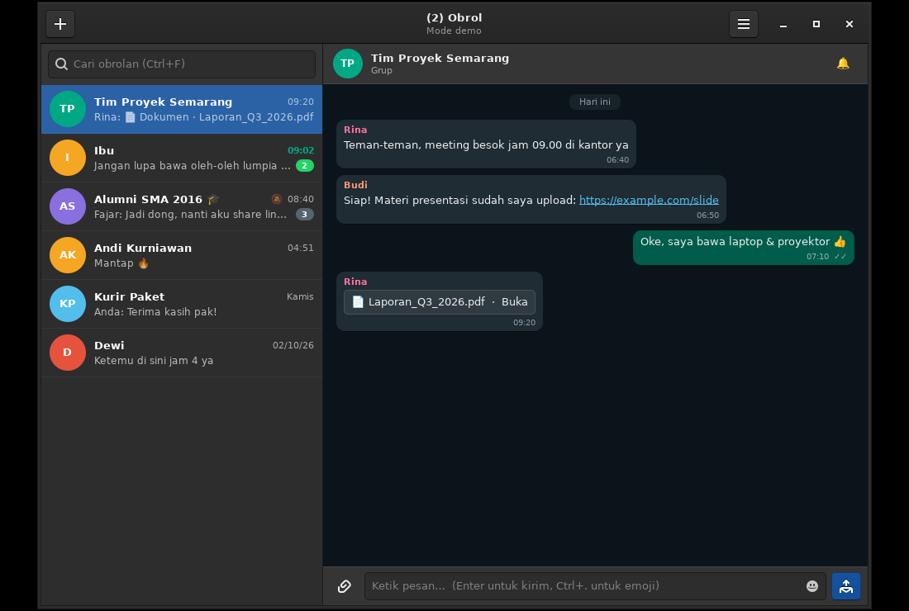
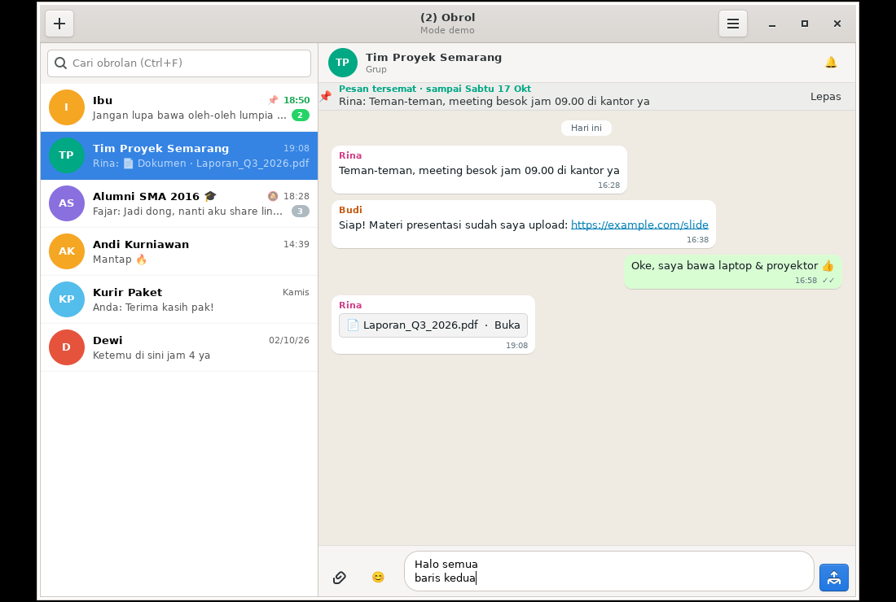
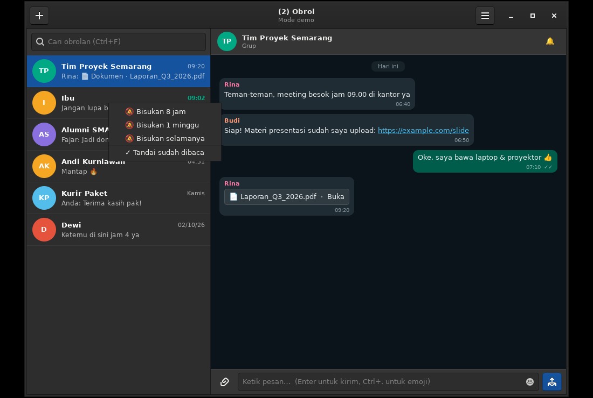
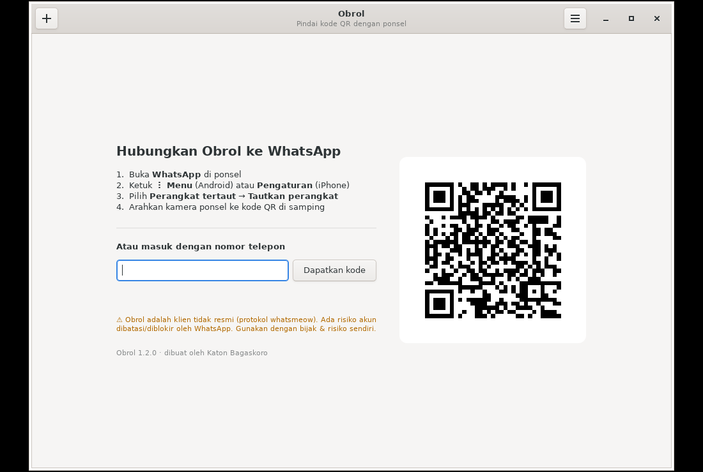
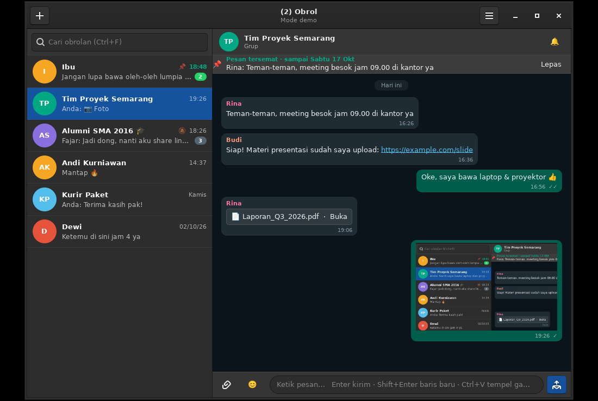
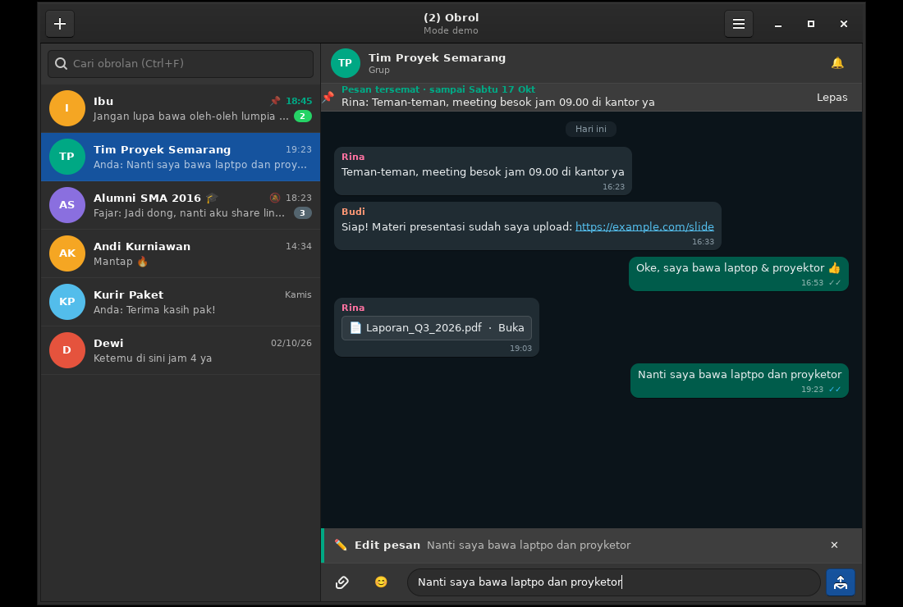
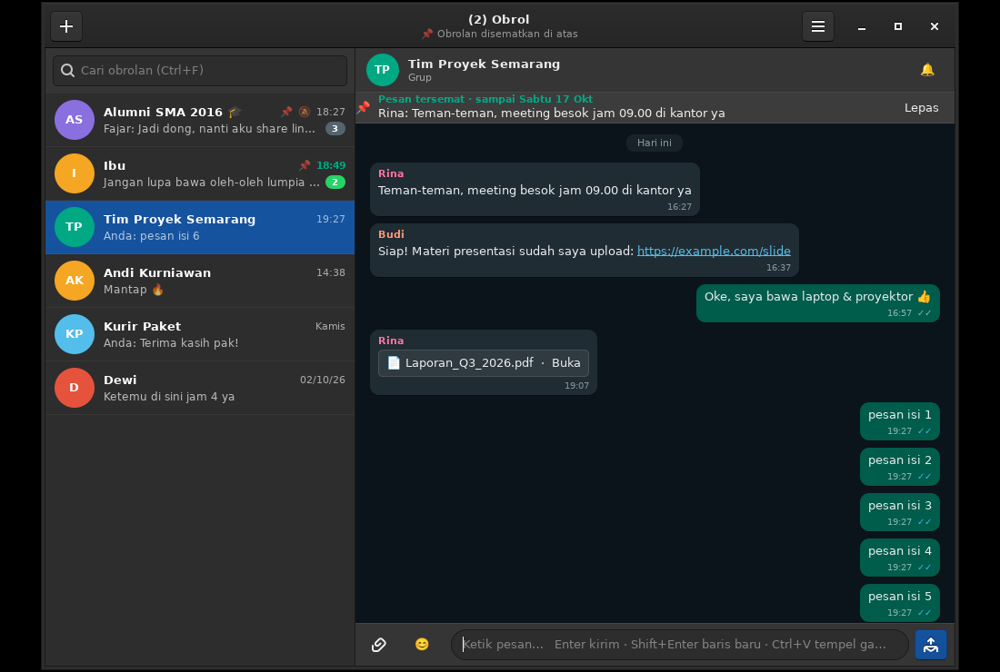
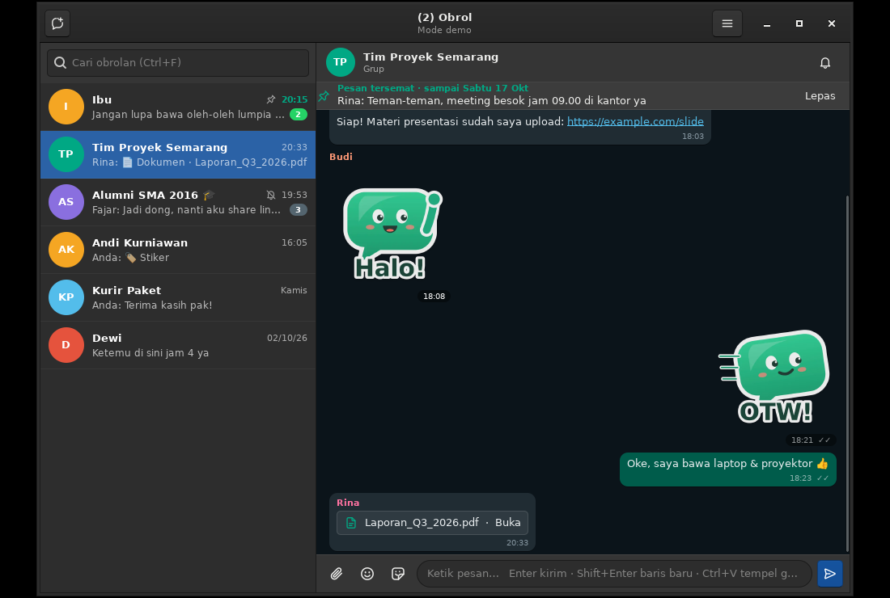
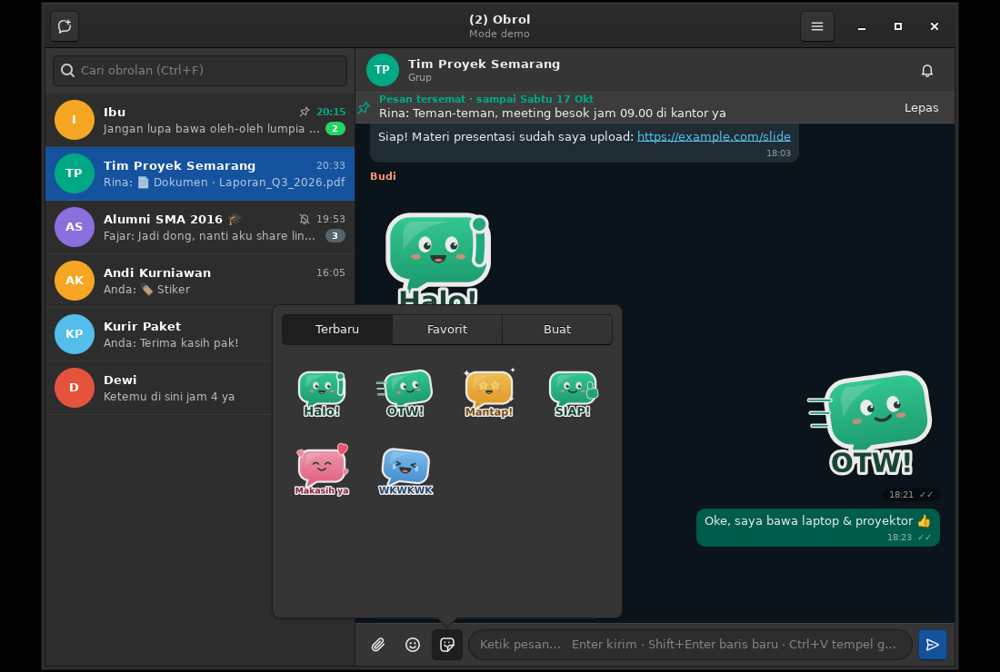
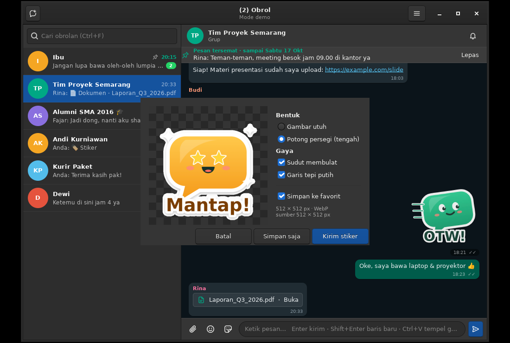

# Obrol: klien WhatsApp native untuk Linux

**[English](README.md)** · **Bahasa Indonesia**

[](https://github.com/GANTI-USERNAME/obrol-wa/actions/workflows/build.yml)
[](https://github.com/GANTI-USERNAME/obrol-wa/releases/latest)
[](LICENSE)
[](go.mod)

Obrol adalah aplikasi WhatsApp desktop yang **benar-benar native** untuk Linux Mint XFCE (juga jalan di Ubuntu, Debian, MATE, dan Cinnamon).
Tidak memakai browser, Electron, maupun WebView. Tampilannya murni **GTK3**, dan koneksinya langsung ke server WhatsApp lewat
[whatsmeow](https://github.com/tulir/whatsmeow), library Go yang menjalankan protokol multi-device WhatsApp.

Dibuat oleh **Katon Bagaskoro**.



| Mode terang | Mute (klik kanan chat) | Login |
|---|---|---|
|  |  |  |

**Baru di 1.2:**

| Tempel screenshot (Ctrl+V) | Edit pesan | Pesan & obrolan disematkan |
|---|---|---|
|  |  |  |

**Baru di 1.3:**

| Stiker (termasuk animasi) | Panel stiker: Terbaru / Favorit / Buat | Buat stiker dari foto atau screenshot |
|---|---|---|
|  |  |  |

## Kenapa ringan?

| | Obrol | WhatsApp Web di browser | Klien Electron |
|---|---|---|---|
| Teknologi | GTK3 + Go (1 binary) | Tab Chrome/Firefox | Chromium terbungkus |
| Ukuran | ±19 MB | – | 150–250 MB |
| RAM | ±100 MB (diukur) | 300–600 MB | 300–500 MB |
| Proses | 1 | Banyak | Banyak |

## Fitur

- ✅ Login lewat **kode QR** atau **kode 8 karakter dari nomor telepon**
- ✅ Daftar chat dengan avatar inisial, pratinjau pesan, jam, dan **badge belum dibaca**
- ✅ **Sinkronisasi riwayat** chat dari ponsel saat pertama login
- ✅ Kirim dan terima teks, emoji (Ctrl+. atau ikon 😊), dan link yang bisa diklik
- ✅ **Centang** ✓ terkirim, ✓✓ diterima, ✓✓ biru dibaca. Laporan baca juga dikirim ke lawan chat
- ✅ Thumbnail **foto/video**; klik untuk mengunduh lalu membuka di aplikasi default
- ✅ Buka dokumen, pesan suara, dan audio (disimpan ke `~/Unduhan/Obrol`)
- ✅ **Stiker**: diterima dan ditampilkan persis seperti di ponsel, **termasuk stiker animasi (WebP bergerak)**.
  Bubble stiker transparan tanpa latar, seperti WhatsApp asli
- ✅ **Kirim foto dan file** (📎) dengan keterangan
- ✅ **Tempel gambar dengan Ctrl+V**: screenshot di clipboard (tombol PrtSc, xfce4-screenshooter, Flameshot) atau
  file yang di-copy dari Thunar/Nemo langsung muncul di dialog kirim, lengkap dengan pratinjau dan keterangan
- ✅ **Pesan multi-baris**: `Enter` untuk kirim, `Shift+Enter` untuk baris baru. Kotak ketik ikut membesar sampai ±7 baris, lalu bisa di-scroll
- ✅ **Edit pesan** yang sudah terkirim (maksimal 15 menit, sama seperti WhatsApp): klik kanan pesan → ✏️ Edit pesan,
  atau tekan `↑` saat kotak ketik kosong untuk mengedit pesan terakhirmu. Pesan yang diedit ditandai "diedit"
- ✅ **Hapus untuk semua orang** (klik kanan pesanmu, maksimal ±2,5 hari)
- ✅ **Sematkan pesan** selama 24 jam, 7 hari, atau 30 hari (klik kanan pesan → 📌). Banner di atas percakapan
  menampilkan pesan yang disematkan; klik banner untuk lompat ke pesannya (kalau ada beberapa, diklik bergiliran)
- ✅ **Sematkan obrolan** di urutan teratas daftar chat (maksimal 3), tersinkron dengan ponsel
- ✅ Chat **grup** dengan nama pengirim berwarna
- ✅ Pesan yang **dihapus** atau **diedit** orang lain ikut ter-update
- ✅ Lokasi (dengan link Google Maps), kontak, dan polling ditampilkan sebagai teks
- ✅ **Notifikasi desktop**; klik notifikasi untuk langsung membuka chat-nya. Ada suara notifikasi juga
- ✅ **Dark mode** ala WhatsApp. Mode *Otomatis* mengikuti tema XFCE (misal Mint-Y-Dark) dan ikut berubah saat tema diganti; bisa juga dipaksa *Terang* atau *Gelap* (Menu ☰ → Tema)
- ✅ **Mute chat/grup** selama 8 jam, 1 minggu, atau selamanya, lewat klik kanan di daftar chat atau tombol 🔔 di header chat.
  Status mute **tersinkron dua arah dengan ponsel**: grup yang sudah kamu bisukan di HP otomatis ikut dibisukan di Obrol
- ✅ **Bisukan semua grup** sekaligus (Menu ☰). Kamu tetap dapat notifikasi kalau ada yang **@mention** atau **membalas pesanmu**
- ✅ Chat yang dibisukan: ikon 🔕, badge abu-abu, dan **tidak dihitung** di judul jendela maupun titik merah tray
- ✅ **Ikon system tray** dengan titik merah saat ada pesan baru. Menutup jendela = sembunyi ke tray
- ✅ **Jalankan saat login** (autostart, langsung tersembunyi di tray)
- ✅ Obrolan baru ke nomor mana pun (nomor dicek dulu apakah terdaftar di WA)
- ✅ Cari chat, separator tanggal (Hari ini/Kemarin/nama hari), riwayat lama dimuat saat scroll ke atas
- ✅ **Panel stiker** (tombol di samping emoji): tab *Terbaru* (stiker yang pernah dipakai/diterima, urut pemakaian),
  *Favorit*, dan *Buat*. Klik untuk mengirim lagi; klik kanan untuk favoritkan atau sembunyikan
- ✅ **Buat stiker sendiri** dari foto/file gambar atau screenshot di clipboard: dipotong persegi otomatis,
  sudut membulat, garis tepi putih, lalu dikirim sebagai stiker WebP ≤100 KB (format stiker WhatsApp)
- ✅ Tombol **"Jadikan stiker…"** langsung di dialog kirim gambar
- ✅ **Ikon & logo buatan sendiri**: logo "Ngobrol" (dua gelembung obrolan) dan 27 ikon garis tipis yang
  digambar khusus sebagai SVG, sehingga tajam di skala berapa pun dan warnanya ikut tema terang/gelap
- ✅ Single-instance: membuka Obrol lagi cukup memunculkan jendela yang sudah ada

**Pintasan:** `Enter` kirim · `Shift+Enter` baris baru · `Ctrl+V` tempel gambar/teks · `↑` edit pesan terakhir ·
`Ctrl+F` cari · `Ctrl+N` obrolan baru · `Esc` batal edit / tutup obrolan · `Ctrl+W` sembunyikan · `Ctrl+Q` keluar

## Instalasi (Linux Mint 21/22, x86_64)

Binary sudah jadi, jadi **tidak perlu install Go**. Unduh tarball terbaru dari
halaman [Releases](https://github.com/GANTI-USERNAME/obrol-wa/releases/latest), lalu:

```bash
tar xzf obrol-1.3.0-linux-x86_64.tar.gz
cd obrol
bash install.sh
```

Setelah itu buka dari **Menu → Internet → Obrol**, atau jalankan `obrol` di terminal.
Instalasinya per-user (tanpa sudo):

- Binary: `~/.local/bin/obrol`
- Menu: `~/.local/share/applications/obrol.desktop`
- Data (sesi login + riwayat chat): `~/.local/share/obrol/`

Menghapus aplikasi:

```bash
bash install.sh --uninstall   # hapus aplikasi, data chat tetap disimpan
bash install.sh --purge       # hapus aplikasi + sesi login + riwayat chat
```

> Agar perangkat juga hilang dari daftar *Perangkat tertaut* di ponsel, pilih **Menu ☰ → Keluar dari akun** sebelum uninstall.

## Build dari source (opsional)

```bash
git clone https://github.com/GANTI-USERNAME/obrol-wa.git
cd obrol-wa
sudo apt install build-essential pkg-config libgtk-3-dev golang-go
./build.sh        # build pertama ±3–6 menit (binding GTK-nya besar)
./install.sh
```

Go 1.22 atau lebih baru sudah cukup. Toolchain 1.26 yang dibutuhkan whatsmeow akan diunduh otomatis.

Opsi baris perintah:

| Opsi | Fungsi |
|---|---|
| `--hidden` | mulai tersembunyi di tray (dipakai autostart) |
| `--demo` | mode demo dengan data contoh, tanpa koneksi |
| `--debug` | tampilkan log whatsmeow di terminal |
| `--version` | tampilkan versi |

## ⚠️ Penting: risiko dan batasan

- **Tidak resmi.** Obrol memakai protokol WhatsApp hasil reverse-engineering (whatsmeow) dan **tidak berafiliasi dengan WhatsApp/Meta**.
  Ini melanggar Ketentuan Layanan WhatsApp. Ada kemungkinan akun **dibatasi atau diblokir**, walaupun untuk pemakaian chat
  normal hal ini jarang terjadi (whatsmeow juga dipakai oleh banyak bridge seperti mautrix-whatsapp). **Jangan dipakai untuk
  spam atau pesan massal.** Kalau khawatir, pakai nomor cadangan dulu.
- **Belum ada:** panggilan suara/video, kirim pesan suara, status/story, reaksi (pesan reaksi tidak ditampilkan),
  balas/kutip pesan, foto profil, dan saluran (channel).
- Pesan "sekali lihat" tidak bisa dibuka (sama seperti WhatsApp Web).
- Kalau WhatsApp mengubah protokolnya, cukup **build ulang** dengan whatsmeow terbaru:
  `go get go.mau.fi/whatsmeow@latest && ./build.sh && ./install.sh`.
- Ponsel harus online minimal sekali setiap ±14 hari, kalau tidak perangkat tertaut akan dilepas otomatis.

## Riwayat versi

Catatan lengkap per rilis ada di [CHANGELOG.md](CHANGELOG.md).

- **1.3.0**: stiker penuh (tampil + animasi, panel Terbaru/Favorit, buat stiker dari gambar/screenshot),
  logo & ikon SVG asli buatan sendiri
- **1.2.0**: tempel screenshot/gambar dari clipboard dengan Ctrl+V, pesan multi-baris dengan Shift+Enter, edit pesan
  (klik kanan atau tombol ↑), hapus untuk semua orang, sematkan pesan (banner + lompat ke pesan), sematkan obrolan,
  pratinjau foto kiriman sendiri lebih tajam, dan kredit pembuat (Katon Bagaskoro) di menu Tentang.
- **1.1.0**: dark mode (otomatis/terang/gelap), mute per chat yang tersinkron dengan ponsel, bisukan semua grup
  kecuali @mention/balasan, badge mute, status sementara di header kembali otomatis ke status koneksi.
  Update dari 1.0.0 cukup dengan `bash install.sh`; sesi login dan riwayat chat tetap aman.
- **1.0.0**: rilis pertama.

## Pemecahan masalah

| Masalah | Solusi |
|---|---|
| Ikon tray tidak muncul | Panel XFCE perlu plugin **Status Tray** (Klik kanan panel → Panel → Add New Items → *Status Tray Plugin*). Tanpa tray, menutup jendela akan keluar dari aplikasi. |
| Tidak ada suara notifikasi | `sudo apt install gnome-session-canberra` (menyediakan `canberra-gtk-play`) |
| Emoji tampil kotak | `sudo apt install fonts-noto-color-emoji` |
| Ingin login ulang / sesi rusak | Menu ☰ → Keluar dari akun, atau hapus `~/.local/share/obrol/` |
| Muncul "Sesi dibuka di tempat lain" | Obrol sedang dijalankan di komputer lain dengan sesi yang sama |

## Struktur kode

```
main.go    entry point, opsi CLI, konfigurasi, data demo
wa.go      koneksi whatsmeow: login, event, riwayat, kirim/terima, media
store.go   database SQLite lokal (chat + pesan)
ui.go      seluruh antarmuka GTK3
features.go kotak ketik multi-baris, tempel gambar, edit/hapus pesan, sematkan pesan & obrolan
tray.go    binding cgo kecil untuk GtkStatusIcon (tray XFCE)
clip.go    binding cgo kecil untuk membaca file yang di-copy dari file manager
icons.go   ikon & logo SVG bawaan (widget DrawingArea yang bisa di-recolor sesuai tema)
stickers_core.go penyimpanan, unduh/kirim, dan encode WebP stiker (dlopen libwebp)
stickers.go panel stiker, pratinjau animasi, dan dialog buat stiker
webp.go    decoder/encoder WebP (termasuk WebP animasi) lewat cgo libwebp
assets/    ikon & logo SVG, stiker demo
```

Obrol © 2026 Katon Bagaskoro. Lisensi kode: MIT. whatsmeow: MPL-2.0. gotk3: ISC.
